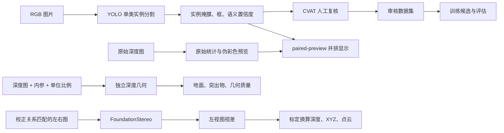

# 工程架构

项目由三条工作线组成：RGB 单类实例分割、独立深度几何、双目视差与点云研究。RGB 给出 `sweepable_litter` 的语义候选；深度计算地面、突出物和尺寸；FoundationStereo 从左右图估计视差，米制换算由网络外的标定处理完成。

## 当前数据流

当前 RGB 与深度没有空间融合连线：`run_perception.py` 输出 `spatial_fusion=false`，RGB 实例的 `geometry=null`。`paired-preview` 展示调用者提供的图像对，不建立像素对应关系。

## 代码分层

| 层次 | 代码 | 职责 |
|---|---|---|
| 图片入口 | [run_perception.py](../run_perception.py)、[run_depth_baseline.py](../run_depth_baseline.py) | 解析参数、读取图像、调用算法并保存结果 |
| RGB 数据处理 | [garbage_auto_annotation/](../garbage_auto_annotation) | 数据转换、来源记录、校验、预测与困难负样本处理 |
| RGB 训练与预测 | [train_garbage_teacher.py](../train_garbage_teacher.py)、[predict_garbage_teacher.py](../predict_garbage_teacher.py) | 训练配置、模型调用、预标注和 CVAT 包 |
| 深度算法 | [detector.py](../depth_perception/detector.py) | 地面拟合、突出物筛选、连通域与外部掩膜测量 |
| 基础几何 | [geometry.py](../depth_perception/geometry.py) | 深度转米、反投影、平面与轮廓、旋转及内参变换 |
| 深度契约 | [types.py](../depth_perception/types.py)、[serialization.py](../depth_perception/serialization.py)、[Schema](../schemas/depth_perception_result.schema.json) | 类型、质量标记与独立深度结果序列化 |
| 配置 | [config/](../config)、[深度配置读取](../depth_perception/config.py) | 模板、算法阈值及历史实验配置 |
| 研究工具 | [tools/](../tools/README.md) | 特定批次编排、分析、报告和导出 |
| 部署 | [deployment/jetson/](../deployment/jetson) | 容器环境与板端运行 |

结果 Schema 对应独立深度结果，不是所有报告的通用格式。统一图片入口会在深度结果外加上运行模式等字段；研究脚本有各自的报告结构。

## RGB 数据与训练

公开数据和采集图像经转换、预标注与人工复核后成为训练输入。模型预测始终是待审核建议；空标签应代表已确认的背景样本。训练候选与已有基准权重分开保存，评估后再决定是否采用。

基础逻辑位于 `garbage_auto_annotation/`，根目录提供 `prepare_*`、`add_reviewed_factory_dataset.py`、`validate_garbage_dataset.py`、训练与预测等 CLI。使用顺序见 [日常工作流](WORKFLOWS.md)，具体来源与历史批次见 [标注流水线](garbage-auto-annotation.md)。

## 深度怎样处理一帧

`DepthObstacleDetector.process(depth_image, intrinsics)` 先按 `depth_scale` 转成米，过滤无效与超范围深度，然后在下部 ROI 采样反投影，使用 RANSAC 拟合地面。它按点到地面的有符号距离筛出突出物，再做形态学和连通域处理，返回地面模型、轮廓、面积、高度、相机坐标和质量标记。

`DepthFrameResult` 保存输入尺寸、有效深度比例、配置与可选帧信息。`geometry_confidence` 描述几何测量质量，与 RGB 的 `semantic_confidence` 分开表达。

`measure_mask(depth_image, intrinsics, instance_mask)` 可测量外部实例掩膜。调用前须将掩膜配准到深度像素坐标系；尺寸相同仅满足数组接口，不证明已配准。薄纸等目标可能低于深度噪声或突出物阈值，因此深度未检出不能直接否决 RGB 候选。

## 双目研究链路

[foundationstereo_runtime.py](../tools/foundationstereo_runtime.py) 提供本机研究使用的标准模型加载与 SDPA 适配，依赖仓库外的 FoundationStereo 源码和环境。部分早期入口保留独立加载逻辑。下载权重并不能替代外部源码与配置。

网络输出左视图视差；深度换算依赖匹配输入模式的标定、校正关系、焦距与基线单位。XYZ 和 PLY/PCD 是后续几何导出。交给下游的数据需要说明像素网格、坐标系、单位和无效值表示；恢复原图尺寸不等于增加观测细节。详细步骤见 [FoundationStereo 流程](foundationstereo-process-notes-20260928.md)。

## 源码、数据与输出分开保存

Git 保存源码、配置模板、文档与下载清单。[fetch_assets.py](../tools/fetch_assets.py) 从 Release 恢复大型资产：基准权重到 `models/best.pt`，数据到清单指定的 `datasets/` 和 `data/`，候选权重到 `models/experiments/`。这些目录无需存在于刚克隆的源码中。

运行结果使用独立的 `outputs/<名称>/`。历史配置通过 [configure_dataset.py](../tools/configure_dataset.py) 生成本机 YAML，不修改下载快照。历史实验工具的迁移边界见 [可复现范围](REPRODUCIBILITY.md)。

## 推荐阅读顺序

先读 `run_perception.py` 的参数与主流程，再读深度 `types.py`、`detector.py`、`geometry.py`。需要 RGB 数据处理时从根目录 CLI 进入 `garbage_auto_annotation/`；需要研究实验时按 [工具索引](../tools/README.md) 找对应入口。

新增通用算法继续放入模块，批次编排和报告放入 `tools/`，具体实验使用独立配置与输出。维护检查随改动范围选择，不把全量训练、回归、冒烟或哈希作为每次修改的固定流程。
