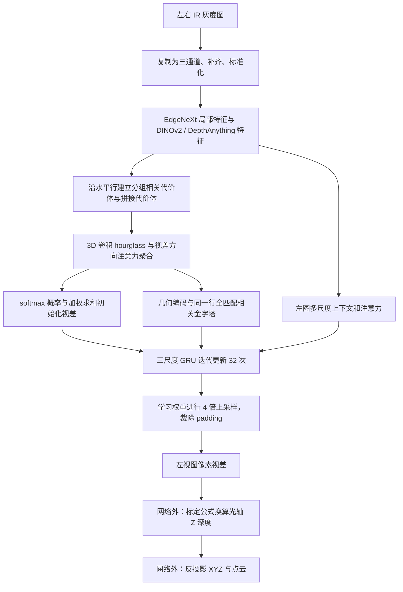

# FoundationStereo 输入、处理与输出：本机源码核对笔记

核对日期：2026-09-28。本文依据本机实际源码与推理入口，供本次全量重跑报告引用。张量尺寸按源码和配置推导，**不是本次额外运行的中间张量跟踪结果**；本核对没有运行 GPU、修改模型或重训。全量运行成功数量、耗时及产物应引用本轮实际运行报告。

## 1. 模型和输入是什么

当前入口使用标准 FoundationStereo 本地工程 `D:/RC/lege/FoundationStereo`，加载 `pretrained_models/23-51-11/model_best_bp2.pth`，文件核对大小为 3,298,527,334 字节。入口设置 `vit_size=vitl`、32 次迭代，并以 `strict=True` 加载完整权重。源码证据：[推理入口第 71 行起](C:/Users/leg/Documents/ChatGPT/yolo/tools/run_stereo_disparity_trial.py:71)。

**网络输入是一对左右图，直接输出的是左图每个像素的视差；相机内参和基线不进入这个网络。** 本项目实际读取左右 IR 灰度 PNG，将每幅灰度图复制成相同的 3 个通道，再转成 `[B,3,H,W]` 的浮点张量，初始像素范围为 0～255。每次处理一对，所以 `B=1`。这只是满足网络的三通道接口，没有给 IR 增加真实颜色。证据：[读图和张量构造第 104 行起](C:/Users/leg/Documents/ChatGPT/yolo/tools/run_stereo_disparity_trial.py:104)、[网络 forward 参数第 194 行起](D:/RC/lege/FoundationStereo/core/foundation_stereo.py:194)。

网络的左右匹配沿**同一水平行**计算，因此几何意义要求左右图满足相应校正与配对条件。本入口不做图像校正重映射；历史 IR 是否已校正、提供的标定是否准确对应原图，仍是米制结果成立的条件。运行过程能输出视差，不等于已经验证这些条件。证据：[水平代价体第 399 行起](D:/RC/lege/FoundationStereo/core/submodule.py:399)、[同一行左右相关第 69 行起](D:/RC/lege/FoundationStereo/core/geometry.py:69)、[运行元数据第 96 行](C:/Users/leg/Documents/ChatGPT/yolo/tools/run_stereo_disparity_trial.py:96)。

DOE=6/0 是样本分组信息，不作为单独数值输入网络；网络看到的是 DOE 对实际 IR 像素产生的变化。既有入口依据分组选择图片，将分组写入结果记录。

## 2. 预处理与原生尺寸

1. 按设备时间戳选左右图并检查尺寸一致。本入口允许唯一已有的时间戳差 1 配对，但明确标为未经验证的暂定配对；不能因此声称所有左右图都已严格同步。[第 86 行起](C:/Users/leg/Documents/ChatGPT/yolo/tools/run_stereo_disparity_trial.py:86)
2. 按命令行 `--scale` 决定网络输入尺寸。`--scale 1` 对原图全尺寸推理；默认值仍是 `0.5`，报告必须依据实际命令和落盘图尺寸区分本次与旧批次。[第 19 行](C:/Users/leg/Documents/ChatGPT/yolo/tools/run_stereo_disparity_trial.py:19)、[第 107 行起](C:/Users/leg/Documents/ChatGPT/yolo/tools/run_stereo_disparity_trial.py:107)
3. 用边缘复制补齐到 32 的整数倍，网络输出后裁掉补齐区。1280×800 已经同时被 32 整除，无须补齐；848×480 宽度需要左右各补 8 像素，网络临时网格为 864×480，最后裁回 848×480。证据：[padding 实现第 17 行起](D:/RC/lege/FoundationStereo/core/utils/utils.py:17)。
4. 网络内部先除以 255，再按通道使用 `mean=[0.485,0.456,0.406]`、`std=[0.229,0.224,0.225]` 做标准化，即 `I'=(I/255-mean)/std`。灰度复制后的三个通道在标准化后数值会不同，因为均值和标准差不同。[第 37 行起](D:/RC/lege/FoundationStereo/core/foundation_stereo.py:37)

原生全尺寸推理不代表网络内部不降采样。模型内部主要在 1/4 网格做视差估计，再通过学习的上采样还原；这与旧批次先把**外部输入**缩小一半、最后用最近邻恢复原图网格是两回事。

## 3. 中间模型怎样处理



### 3.1 同时提取局部纹理和预训练视觉特征

模型把左右图沿 batch 维拼接，共用同一个特征提取器。EdgeNeXt-small 分支提取多尺度特征；另一个分支调用基于 DINOv2 的 DepthAnything 特征器，当前为 ViT-L。随后融合两类特征，并重新拆分左右图。源码中 DINO/DepthAnything 分支设为冻结、`eval()` 与 `no_grad()`；本次入口整体处于推理模式。[左右共用提取器第 201 行起](D:/RC/lege/FoundationStereo/core/foundation_stereo.py:201)、[Feature 定义第 323 行起](D:/RC/lege/FoundationStereo/core/extractor.py:323)

ViT 分支会将图像插值到符合 14 像素 patch 与 16 倍数约束的内部尺寸，并把提取的特征插值回主干的 1/4 网格。具体实现以 `lcm(14,16)=112` 向上取整、最大高宽 1344；例如 1280×800 输入对应该分支内部 1344×896。这里改变的是特征分支的内部处理尺寸，最终输出坐标仍回到主输入网格。[第 348 行起](D:/RC/lege/FoundationStereo/core/extractor.py:348)、[尺寸函数第 89 行起](D:/RC/lege/FoundationStereo/Utils.py:89)

`DepthAnythingFeature` 同时计算一个单目相对视差辅助结果，但 FoundationStereo 的 `Feature.forward()` 实际取用 `output['out']` 特征进行融合，**不是把这个单目相对结果当作最终双目视差或米制深度输出**。[辅助输出第 308 行起](D:/RC/lege/FoundationStereo/core/extractor.py:308)、[取用特征第 355 行起](D:/RC/lege/FoundationStereo/core/extractor.py:355)、[辅助相对视差第 135 行起](D:/RC/lege/FoundationStereo/depth_anything/dpt.py:135)

### 3.2 构造和聚合候选匹配代价

在 1/4 分辨率上，对多个候选水平位移比较左右特征：

- 分组相关：把特征通道分为 8 组，在每组内归一化后计算相似度，形成 8 通道代价体。
- 特征拼接：左右特征各投影为 12 通道，按候选位移对齐并拼接，形成 24 通道代价体。
- 两者拼为 32 通道，经过卷积转为 28 通道，再用左图特征注意力、3D hourglass 和沿视差方向的 Transformer 注意力聚合。

配置 `max_disp=416`，构造代价体时使用 `416/4=104` 个候选索引。该配置是初始代价体的搜索尺度，**不能当作最终视差被硬裁剪到 416 的保证**；后续迭代会继续加上视差修正量。证据：[配置](D:/RC/lege/FoundationStereo/pretrained_models/23-51-11/cfg.yaml:13)、[代价体流程第 207 行起](D:/RC/lege/FoundationStereo/core/foundation_stereo.py:207)、[分组和拼接实现第 388 行起](D:/RC/lege/FoundationStereo/core/submodule.py:388)。

hourglass 用下采样、上采样及跳跃连接聚合空间与视差信息；并行的代价体注意力分支先以 4 倍步长压缩三维代价体，再以每个空间位置的视差序列做 4 层、4 头注意力，插值后与卷积分支相加。证据：[hourglass 定义第 45 行起](D:/RC/lege/FoundationStereo/core/foundation_stereo.py:45)、[注意力的序列重排第 506 行起](D:/RC/lege/FoundationStereo/core/submodule.py:506)。

### 3.3 初始化与 32 次迭代细化

聚合后的代价体经分类头得到候选视差分数，沿视差维做 softmax，再对候选索引做概率加权求和，得到初始视差。此时视差仍使用 1/4 特征网格的像素单位。[第 217 行起](D:/RC/lege/FoundationStereo/core/foundation_stereo.py:217)、[加权回归第 431 行起](D:/RC/lege/FoundationStereo/core/submodule.py:431)

左图另生成 1/4、1/8、1/16 三尺度上下文，分别经 tanh 与 ReLU 得到隐状态和上下文，再计算通道/空间注意力。几何编码将已聚合代价体与左右特征的同一行全匹配相关构造成 2 层金字塔；在每次当前视差附近，以半径 4 采样邻域，送入更新模块。[上下文初始化第 222 行起](D:/RC/lege/FoundationStereo/core/foundation_stereo.py:222)、[几何编码第 17 行起](D:/RC/lege/FoundationStereo/core/geometry.py:17)

三尺度选择性 ConvGRU 更新模块融合上下文、当前视差、邻域相关和相邻尺度状态，输出 `delta_disp`；每次执行 `disp = disp + delta_disp`。本入口指定 32 次，测试模式只对最后一次结果做全尺寸上采样。这里的 32 次是一次前向推理内部的迭代，**不是训练 32 轮**。[迭代第 235 行起](D:/RC/lege/FoundationStereo/core/foundation_stereo.py:235)、[选择性 GRU 第 98 行起](D:/RC/lege/FoundationStereo/core/update.py:98)、[三尺度更新第 141 行起](D:/RC/lege/FoundationStereo/core/update.py:141)

### 3.4 学习的上采样

最终 1/4 视差先乘 4，换回输入像素单位；网络依据更新特征和左图 1/2 特征预测 9 个邻域权重，并对权重做 softmax。随后对低分辨率 3×3 视差邻域加权组合，得到全尺寸视差，再裁掉输入 padding。这是模型学习的邻域加权上采样，不是简单把最终小图最近邻放大。[第 183 行起](D:/RC/lege/FoundationStereo/core/foundation_stereo.py:183)、[context_upsample 第 456 行起](D:/RC/lege/FoundationStereo/core/submodule.py:456)、[去 padding 第 118 行](C:/Users/leg/Documents/ChatGPT/yolo/tools/run_stereo_disparity_trial.py:118)

### 3.5 1280×800 原生输入的主要张量尺寸

以下均按 `[batch,channel,height,width]`，代价体额外包含视差候选维；均为配置推导。

| 位置 | 张量尺寸 | 作用 |
|---|---|---|
| 单幅左/右输入 | `[1,3,800,1280]` | 灰度复制三通道 |
| 左右合并输入 | `[2,3,800,1280]` | 共享特征提取 |
| 每侧 1/4 融合特征 | `[1,224,200,320]` | 主匹配特征 |
| 每侧 1/8、1/16、1/32 特征 | `[1,192,100,160]`、`[1,320,50,80]`、`[1,304,25,40]` | 多尺度引导 |
| 分组相关代价体 | `[1,8,104,200,320]` | 8 组相似度 |
| 拼接代价体 | `[1,24,104,200,320]` | 左右各 12 通道 |
| 拼接后的代价体 | `[1,32,104,200,320]` | 相关与特征结合 |
| 聚合后代价体 | `[1,28,104,200,320]` | 几何编码 |
| 初始/迭代视差 | `[1,1,200,320]` | 1/4 网格像素单位 |
| 每次查询的几何特征 | `[1,522,200,320]` | `2×9×(28+1)` 个通道 |
| 最终网络返回值 | `[1,1,800,1280]` | 全尺寸输入像素单位的视差 |
| 保存的视差 NPY | `[800,1280]`、float32 | 去掉 batch 和 channel 维 |

通道数依据 [特征输出第 330 行起](D:/RC/lege/FoundationStereo/core/extractor.py:330)、[ViT-L 配置第 287 行起](D:/RC/lege/FoundationStereo/core/extractor.py:287)、[几何查询通道数第 55 行](D:/RC/lege/FoundationStereo/core/update.py:55)。848×480 样本需先补到 864×480，以上空间尺寸随之变化，最终仍裁回 848×480。

## 4. Windows 的 SDPA 适配做了什么

本机运行入口在进程内建立 `flash_attn` 兼容模块，用 PyTorch 的 `scaled_dot_product_attention` 代替原 FlashAttention 调用，不修改 D 盘原工程文件。它将原本 `[B,L,heads,head_dim]` 排列转换为 SDPA 所需的 `[B,heads,L,head_dim]`，透传 `dropout_p` 与 `softmax_scale`，并用布尔 mask 表示局部窗口；`window_size=(-1,-1)` 时为完整注意力。本次源码中代价体注意力使用默认完整窗口。`causal=True` 或未知额外参数会直接报错，而不是静默忽略。[兼容层第 37 行起](C:/Users/leg/Documents/ChatGPT/yolo/tools/run_stereo_disparity_trial.py:37)、[原注意力调用第 211 行起](D:/RC/lege/FoundationStereo/core/submodule.py:211)

入口同时将骨干的独立初始化下载改为本地构造，随后用完整 checkpoint 的 `strict=True` 加载覆盖参数。`strict=True` 确认参数名称/形状匹配，并不证明 SDPA 与另一套 FlashAttention 环境逐位数值一致；本报告不把两者的数值等价或性能等同当作已验收结论。实际运行采用 CUDA 推理模式和 float16 autocast，部分源码操作显式使用 float32，最终视差保存为 float32。[第 57 行起](C:/Users/leg/Documents/ChatGPT/yolo/tools/run_stereo_disparity_trial.py:57)、[推理及转 float32 第 114 行起](C:/Users/leg/Documents/ChatGPT/yolo/tools/run_stereo_disparity_trial.py:114)

## 5. 输出及几何后处理分别是什么

### 网络输出：像素视差

`d(u,v)` 表示左像素与匹配右像素的水平位移，约定 `u_R=u_L-d`。`disparity_pixels.npy` 是直接网络视差数组。`inverse_disparity_nonmetric.npy=1/d` 仅用于相对远近表达，单位为 1/像素，不能当成米。视差伪彩色和预览图只帮助观察，不承载精确数值。[输出第 118 行起](C:/Users/leg/Documents/ChatGPT/yolo/tools/run_stereo_disparity_trial.py:118)

正有限掩膜表示 `isfinite(d) && d>0`；水平重叠掩膜再要求 `0≤u-d≤W-1`。这些是数值/几何筛选，**不是网络置信度、不是遮挡已完全剔除的证明，也不是精度指标**。本流程没有执行左右一致性检查来验证每个像素。[第 119 行起](C:/Users/leg/Documents/ChatGPT/yolo/tools/run_stereo_disparity_trial.py:119)

### 网络外后处理：米制光轴深度

只有在左右图满足相应校正几何、内参与基线适用的条件下，才按下式换算：

```text
Z_m = fx_px × baseline_m / [d_px − (cx_left − cx_right)]
```

本机已有 Orbbec 标定副本给出 1280×800 的 `fx=fy=620.138794`、`cx=637.5`、`cy=406`，左右主点相同，基线 `95.2326965 mm=0.0952326965 m`，因此原生尺寸按 `Z_m=59.05748955687802/d_px` 换算。半分辨率推理时焦距与视差单位同时减半，系数为 `29.52874477843901`，不能在原生视差上继续使用旧半分辨率系数。[标定副本](C:/Users/leg/Documents/ChatGPT/yolo/outputs/depth/orbbec_cargo_pair2_metric_20260924/calibration.json)、[校验与单位换算第 57 行起](C:/Users/leg/Documents/ChatGPT/yolo/tools/apply_stereo_calibration_trial.py:57)、[原生视差直接换算第 172 行起](C:/Users/leg/Documents/ChatGPT/yolo/tools/measure_cargo_review.py:172)

输出 `depth_m_provisional.npy` 已经是米，不能再次乘标定文件给设备原始深度使用的 `depth_unit_mm`。无效处填 NaN。这里的 Z 是沿光轴的深度，不是三维点到光心的欧氏距离。848×480 的第 24 组没有对应模式标定，应保留视差，不能直接套用 1280×800 参数输出米制值。

### 网络外后处理：XYZ、点云与货物尺寸

逐像素反投影为：

```text
X = (u − cx) × Z / fx
Y = (v − cy) × Z / fy
XYZ[v,u] = [X,Y,Z]
```

XYZ 使用左 IR 光学坐标系，X 向右、Y 向下、Z 向前，单位米；无效位置三个通道均为 NaN。PLY 只是把有效 XYZ 保存为点集，当前灰度颜色来自左 IR，不等于与 RGB 完成配准。[反投影实现](C:/Users/leg/Documents/ChatGPT/yolo/depth_perception/geometry.py:61)、[XYZ 导出与坐标定义](C:/Users/leg/Documents/ChatGPT/yolo/tools/export_stereo_xyz_sample.py:38)

FoundationStereo 本身不直接输出货物长宽高。既有尺寸实验还需要独立的货物/参考板 ROI、平面拟合、顶面支持区域、矩形估计和高度计算。网络全量输出、米制几何换算、具体物体尺寸误差，是三个不同层面的结果；没有逐物体真值时不能把全量运行成功当作尺寸精度验收。[既有测量方法入口](C:/Users/leg/Documents/ChatGPT/yolo/tools/measure_cargo_review.py:84)
